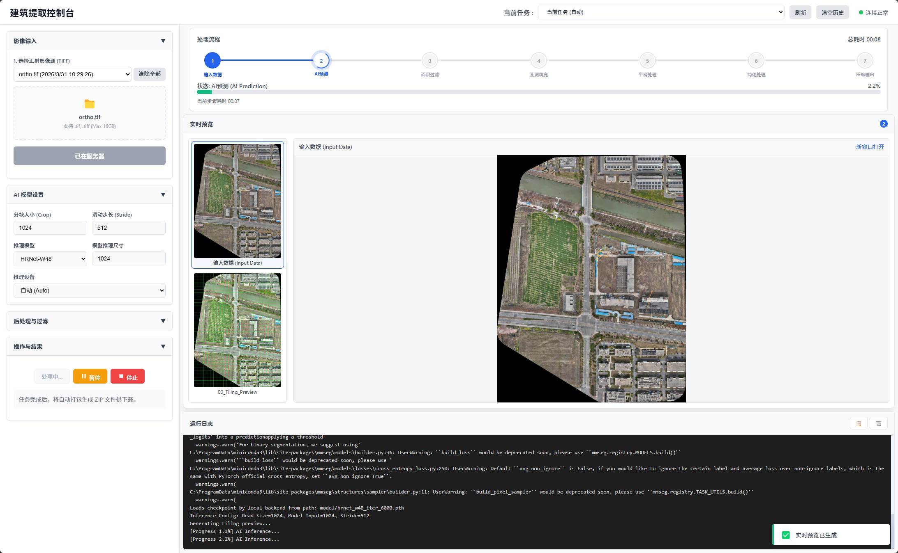
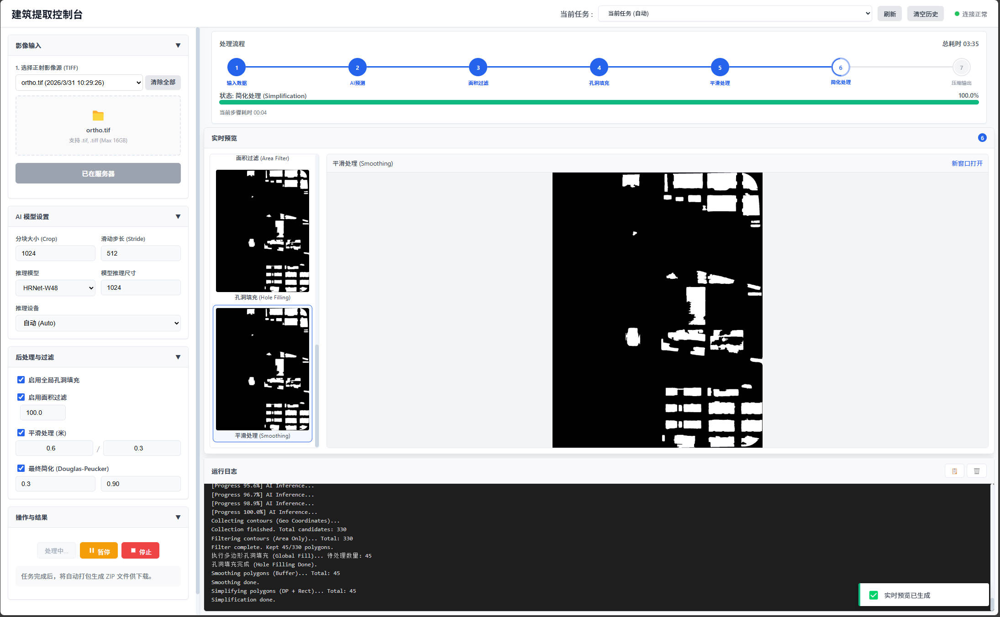

# Footprint-Creater

[](LICENSE)
[](https://www.python.org/)
[](https://pytorch.org/)
[](https://github.com/UVE1048/Footprint-Creater/stargazers)
[](https://github.com/UVE1048/Footprint-Creater/commits/main)

**从高分辨率正射影像自动提取建筑物轮廓，直接输出可入库的 Shapefile。**

Automatic building footprint extraction from high-resolution orthophotos — HRNet semantic segmentation with block-wise inference, geometry-aware post-processing, and a Flask console that streams per-stage previews.



---

**也叫**：建筑物提取工具 · 建筑物轮廓提取 · 房屋面提取 · 建筑图斑提取 · 建筑轮廓矢量化 · 建筑物普查 · building footprint extraction · building polygon extraction

**什么时候该用**：你有带地理参考的高分辨率正射影像，需要一批能直接进 GIS 的建筑物轮廓。
**什么时候不该用**：只有 1–2 张图要手工描（直接矢量化更快）；要提取道路、水系、植被等其他要素（需换模型）。

## 这是什么

给一张带地理参考的正射影像（`.tif`），吐出一个建筑物轮廓 `.shp`。

链路是 **分块 AI 推理 → 全局合并 → 全局轮廓校验 → 规则化输出**。和"跑个语义分割模型就完事"的区别在于后两步：像素级的掩码直接转矢量会得到大量锯齿、粘连和碎块，必须先做形状校验再规则化，结果才能真的进 GIS 用。

前端是个 Flask 控制台，六个阶段的中间结果实时可见 —— 出问题时你能立刻定位是推理错了还是后处理错了，不用等跑完再猜。

**关键词**：建筑物轮廓提取 · 建筑物提取 · 房屋面提取 · 建筑图斑 · 正射影像 · 遥感影像 · 语义分割 · 实例分割 · 边缘规则化 · 多边形简化 · 直角化 · Shapefile · 建筑物普查 · 城市更新 · 违法建设监测 · 三维重建前处理
**Keywords**: building footprint extraction · building segmentation · building detection · semantic segmentation · HRNet · MMSegmentation · remote sensing · aerial imagery · orthophoto · GIS · shapefile · polygon regularization · Douglas-Peucker · OpenStreetMap buildings · 3D building reconstruction

## 特性

| 能力 | 说明 |
| :--- | :--- |
| Web 控制台 | 任务管理、参数配置、六阶段实时预览、日志流式输出、历史任务回溯 |
| 全自动提取 | 上传 `.tif` → 点开始 → 下载 ZIP（SHP + 预览图） |
| 稳健性 | 自动识别 Nodata / 黑边，断点状态恢复，失败任务可单独重启 |
| 双模型切换 | HRNet-W32（快）/ HRNet-W48（准），界面下拉切换 |
| 参数全暴露 | 分块、重叠、面积阈值、平滑膨胀/腐蚀、简化公差、矩形化 IoU 均可调并存档 |
| 零前端依赖 | HTML/JS 全部内联在 `web_app.py`，不依赖 CDN 或外部框架 |

## 为什么流程是这个顺序

把语义分割直接套到大影像上会撞三堵墙，本项目的所有设计取舍基本都围着它们：

1. **大图装不进显存** → 滑窗分块推理，块间 50% 重叠，最后 OR 合并全局掩码
2. **拼缝产生假轮廓** → 先在全局掩码上做轮廓校验，再做平滑与简化，而不是逐块美化后拼接
3. **影像黑边被误判成建筑** → 推理前用 Nodata + 纯黑 + 植被 + 阴影掩码把干扰区涂黑，推理后强制剔除

第三点最容易踩坑：一块斜切的正射影像四周是黑的，模型会稳定地把边界黑区识别成大片"建筑"，面积过滤又因为连成一片而拦不住。所以掩码是**前置**的，不是后置修补。

## 快速开始

```bash
git clone https://github.com/UVE1048/Footprint-Creater.git
cd Footprint-Creater

python -m venv .venv && source .venv/bin/activate   # Windows: .venv\Scripts\activate
pip install -r requirements.txt

# 下载预训练权重（约 773 MB，带 SHA256 校验）
python scripts/download_models.py

python web_app.py
```

浏览器打开 <http://localhost:5000>。

> **装不上 mmcv？** 全量版需要编译 CUDA 算子。纯推理用 `pip install mmcv-lite>=2.1.0` 即可 ——
> `extract_buildings.py` 已内置 `mmcv.ops` 缺失时的 polyfill，不需要 GPU 算子也能跑。

## 使用流程

**1. 上传影像** — `.tif` / `.tiff`，单文件上限 16 GB。必须是**带地理参考的正射影像**（含像素大小与坐标系），否则面积过滤与 SHP 输出都会失效。

**2. 配置参数** — 分块大小/重叠按显存调；W32 默认，追精度换 W48；后处理开关可单独关闭以便定位问题。

**3. 开始处理** — 依次执行 6 个阶段，顶部进度条实时更新，中间预览区显示当前阶段掩码：



**4. 下载结果** — 完成后打包 `<任务名>.zip`（落在 `outputs/`），内含 `buildings.shp` 全家桶 + 预览图。

## 模型权重

权重共约 773 MB，通过 GitHub Releases 分发（不进 git）：

```bash
python scripts/download_models.py                 # 两个都下
python scripts/download_models.py --model w32     # 只下 W32
python scripts/download_models.py --check         # 校验完整性
```

| 文件 | 骨干 | 体积 | 说明 |
| :--- | :--- | :--- | :--- |
| `iter_40000.pth` | HRNet-W32 + FCNHead | ~231 MB | 默认，速度快 |
| `hrnet_w48_iter_6000.pth` | HRNet-W48 + FCNHead | ~542 MB | 精度更高，约 2× 耗时 |

权重放在 `model/` 下即可。也可以用自己的数据训一份 —— 见 [HRNet-Footprint-Trainer](https://github.com/UVE1048/HRNet-Footprint-Trainer)。

## 参数

| 参数 | 默认值 | 作用 | 什么时候改 |
| :--- | :--- | :--- | :--- |
| `BLOCK_SIZE` | 1024 | 分块推理像素尺寸 | 显存不足调小；大建筑常被切断调大 |
| `BLOCK_OVERLAP` | 512 | 分块重叠像素 | 保持 `BLOCK_SIZE` 的 50%，低于 25% 拼缝明显 |
| `AI_IMG_SIZE` | 1024 | 送入网络的缩放尺寸 | 一般不动，换模型时才需要 |
| `MIN_AREA_M2` | 100.0 | 最小建筑面积（m²） | 要小棚房调小；只要主楼调大 |
| `BUFFER_EXPAND_M` | 0.6 | 平滑膨胀距离（m） | 边缘断裂多时增大 |
| `BUFFER_SHRINK_M` | 0.3 | 平滑腐蚀距离（m） | 常规取膨胀值的一半 |
| `SIMPLIFY_TOL` | 0.3 | Douglas-Peucker 公差（m） | 要更平直的边调大，保留细节调小 |
| `RECT_IOU_THRESH` | 0.90 | 矩形化 IoU 阈值 | 阈值越低越多图斑被强制成矩形 |

## 算法流程

完整推导与每步调试产物见 **[docs/Algorithm_Logic.md](docs/Algorithm_Logic.md)**。

| 阶段 | 步骤 | 做什么 |
| :--- | :--- | :--- |
| P1 分块 | 1. 预处理 | 边缘 Padding、生成 Nodata / 植被 / 阴影掩码 |
| | 2. AI 推理 | 干扰区涂黑后推理，再把干扰区从结果强制置零 |
| P2 全局 | 3. 合并 | 各块掩码 OR 合并为全局掩码 |
| | 4. 全局填洞 | 仅做轮廓填充，消除内部空洞 |
| | 5. 轮廓校验 | 面积 / 宽度 / 矩形度 / 实心度 / 植被冲突 / 阴影支撑 |
| | 6. 孔洞填充 | 对保留图斑填补内部孔洞 |
| P3 规则化 | 7. 平滑 | `join_style=mitre` 先膨胀后腐蚀，保直角不圆角 |
| | 8. 简化 | Douglas-Peucker + 矩形化（IoU > 0.90 替换为最小外接矩形） |
| | 9. 输出 | 生成 Shapefile 并打包 ZIP |

规则化刻意用 `mitre` 而非圆弧连接：建筑的边是直的，圆角化后在 GIS 里做拓扑检查会对不上。

## 与替代方案对比

| 方案 | 需要标注数据 | 边缘规则化 | 大图处理 | 部署形态 | 成本 |
| :--- | :--- | :--- | :--- | :--- | :--- |
| **Footprint-Creater** | 用现成权重即可 | ✅ 简化 + 矩形化 | ✅ 滑窗分块 | Web 控制台 / Docker 可包 | 免费 MIT |
| 通用遥感分割模型直接转矢量 | 否 | ❌ 锯齿、粘连 | 需自行分块 | 纯脚本 | 免费 |
| 商业遥感信息提取软件 | 否 | ✅ | ✅ | 桌面 | 授权费高 |
| 手工矢量化 | — | ✅ | — | 人工 | 人力成本极高 |

第二列和第三列是关键差异：多数开源方案给你一张掩码就结束了，从掩码到能入库的图斑中间那一步（校验 + 规则化）才是真正耗时的部分。

## 输出

```text
outputs/<任务名>.zip
├── buildings.shp / .shx / .dbf / .prj
└── 预览图
```

矢量会尽量转成整数 EPSG 码再写出，保证 `.prj` 在各家 GIS 里都能正确识别；拿不到 EPSG 时退回原始 CRS WKT 并手工补写 `.prj`。

开启 `DEBUG_MODE` 后 `debug/` 目录保留各阶段中间栅格，命名规则见算法文档，可逐段排查问题出在哪一步。

## 性能参考

单张 10 cm GSD、约 2 km × 2 km 的正射影像，8 GB 显存 + `BLOCK_SIZE=1024 / OVERLAP=512` 下，W32 全流程约 30–40 秒量级（与地物密度强相关），W48 约翻倍。主要开销在 AI 推理，后处理通常在秒级（除非图斑上万）。

## 项目结构

```text
.
├── web_app.py               # Flask 控制台：路由、任务调度、内联前端
├── extract_buildings.py     # 提取算法核心：推理 + 后处理 + 矢量导出
├── scripts/download_models.py
├── model/README.md          # 权重说明（.pth 不入库）
├── docs/Algorithm_Logic.md  # 算法设计文档
└── assets/
```

运行时自动生成：`uploads/`、`outputs/`、`debug/`（均已在 `.gitignore` 中排除）。

## 引用

```bibtex
@software{footprintcreater2026,
  title  = {Footprint-Creater: Automatic building footprint extraction from orthophotos},
  author = {UVE},
  year   = {2026},
  url    = {https://github.com/UVE1048/Footprint-Creater}
}
```

## 相关项目

同一套实景三维链路上的其他工具：

- [ObjOrthoRender](https://github.com/UVE1048/ObjOrthoRender)：OBJ 模型转带地理参考的 GeoTIFF 正射影像
- [Footprint-Creater](https://github.com/UVE1048/Footprint-Creater)：正射影像建筑物轮廓提取，输出 Shapefile ←
- [HRNet-Footprint-Trainer](https://github.com/UVE1048/HRNet-Footprint-Trainer)：建筑物分割模型训练：切片、训练、大图推理
- [VideoFusion-Web](https://github.com/UVE1048/VideoFusion-Web)：无人机视频融合投射到三维实景模型

在线文档：<https://uve1048.github.io/footprint-creater/>

## 许可

代码以 [MIT](LICENSE) 协议开源。**本项目发布的预训练权重同样以 MIT 提供**，可商用。

基于 MMSegmentation（Apache-2.0）构建，遵循其原始协议。其余依赖：PyTorch(BSD-3)、rasterio(BSD-3)、GeoPandas(BSD-3)、Shapely(BSD-3)、Flask(BSD-3)、OpenCV(Apache-2.0)。

> 使用者需自行确保输入影像的获取与使用符合当地测绘与数据合规要求。
